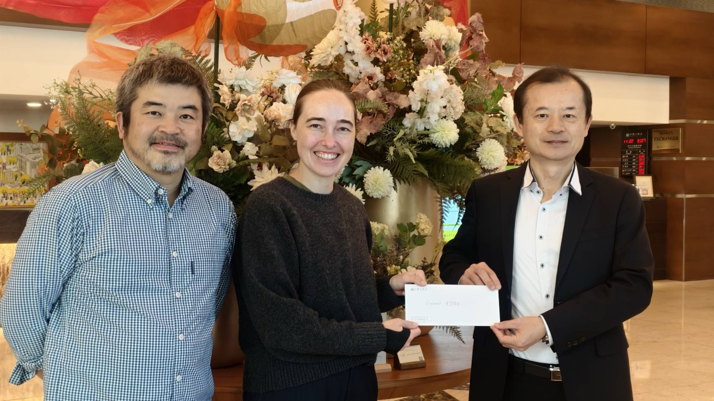

iFuzzy2026において，Lynn pickering先生の論文がBest Conference Paper Award on Fuzzy Theory 1st Placeを受賞しました．

 
{: width="400"}
 

=出典情報=

L. Pickering, B. De Baets, N. Masuyama, and Y. Nojima, "Mapping interpretability trade-offs in fuzzy rule-based and machine learning models using MAP-Elites," in Proc. of 2026 International Conference on Fuzzy Theory and Its Applications (iFuzzy2026), Taichung, Taiwan, Nov. 20-22, 2026. 
